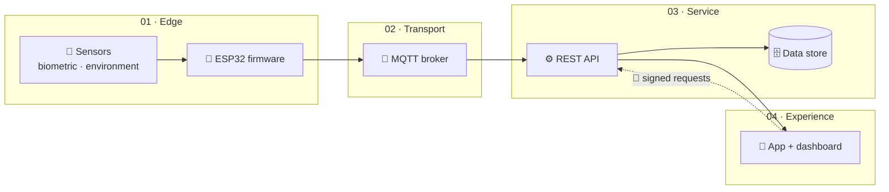

<!-- Profile README · github.com/fuuyuki -->

<div align="center">


<a href="https://github.com/fuuyuki">
  
</a>

<br/>


</div>

---

## 👋 A little context

I'm an implementation engineer who likes the unglamorous half of engineering: making the pieces actually fit together, then writing it down so the next person doesn't have to guess. Most of my work lives where **hardware meets software** — firmware on a bench, a broker in the middle, a clean API in front of it.

## 🧩 What I do

| 💻 Implementation Engineer | 🤖 Robotics Instructor | 📡 IoT Architect |
| :--- | :--- | :--- |
| I turn business requirements into **scalable technical solutions**, then own the integration, deployment, and documentation that keep them working in the real world. | I teach robotics, AI, and embedded systems through **hands-on, scaffolded labs** — small steps, real hardware, immediate feedback. | I design **staged IoT pipelines** (MQTT → REST → app) with security and observability built in, aimed at healthcare and biometric use cases. |

## ⚙️ How I work

- **Empirical over assumed** — benchmark hardware and firmware under load, stress-test with dummy datasets, ship reproducible builds.
- **Modular troubleshooting** — isolate the layer, verify the assumption, then automate the fix.
- **Docs as a deliverable** — if someone else can't rebuild it from the notes, it isn't finished.

## 🏗️ The shape of an IoT system



<sub>My default blueprint: each stage is independently testable, so a failure at the edge never becomes a mystery in the app.</sub>

## 🧰 Toolbox

<p align="center">
  
</p>

<p align="center">
  
  
  
  
  
  
</p>

## 📈 By the numbers

```text
Language mix                 Contribution trend
──────────────────────       ─────────────────────────────
Python  ████████  40%        2023  █████░░░░░░░░░░░░░░░  120
C++     ███████   35%        2024  █████████████░░░░░░░  300
Java    █████     25%        2025  ████████████████████  450
```

<details>
<summary><b>✨ Beyond the code</b></summary>
<br/>

- Building reproducible, modular systems — technical and personal.
- Exploring ethical investing and how wealth circulation touches the real economy.
- Designing secure IoT platforms with biometric security for healthcare applications.
- 25 public repositories and counting.

</details>

## 🤝 Let's talk

<p align="center">
  <a href="https://www.linkedin.com/in/muhammad-fikra-adzaky-9782941b2/">
    
  </a>
  <a href="https://www.instagram.com/fikra_fa">
    
  </a>
</p>

<p align="center"><i>Always up for a conversation about robots, sensors, or clean deployment.</i></p>


